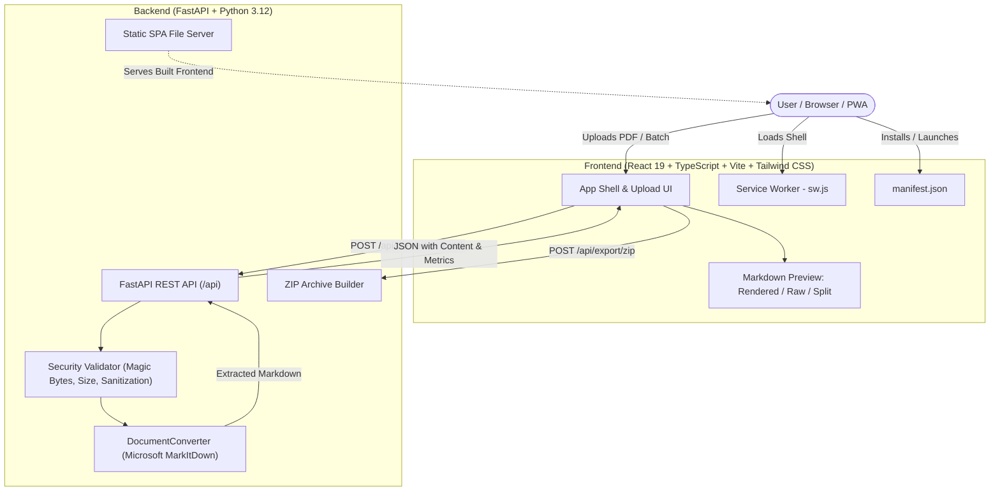

# MarkItDown PWA - PDF to Markdown Converter

[](https://python.org)
[](https://fastapi.tiangolo.com)
[](https://react.dev)
[](https://vitejs.dev)
[](https://web.dev/progressive-web-apps/)
[](LICENSE)

A lightweight, installable **Progressive Web Application (PWA)** that allows users to upload PDF documents and convert them into clean, readable Markdown (`.md`) files using Microsoft's open-source [MarkItDown](https://github.com/microsoft/markitdown) library.

The application makes document conversion simple, fast, private, and accessible across desktop and mobile devices.

---

## 🌟 Key Features

- **Microsoft MarkItDown Integration:** Leverages Microsoft's open-source conversion engine to intelligently convert PDF text, headers, lists, code snippets, and tables into clean Markdown.
- **Progressive Web App (PWA):** Fully installable on Windows, macOS, Android, and iOS. Includes Web App Manifest, app shell caching via Service Worker (`sw.js`), and offline resilience.
- **Batch Processing & ZIP Export:** Upload single or multiple PDF documents concurrently. Download individual `.md` files or export all converted files in an organized `.zip` bundle with a conversion manifest.
- **Interactive Markdown Preview:** Toggle between **Rendered HTML** (sanitized with DOMPurify), **Raw Markdown** (code editor view), and **Split View** (side-by-side).
- **1-Click Copy & Download:** Instantly copy formatted Markdown to the clipboard or download `.md` files with a single click.
- **Sample Document Generator:** Built-in "Try Sample PDF" feature to instantly test and explore the conversion pipeline without locating a PDF file.
- **Privacy & Security First:**
  - Files are processed **100% in-memory** — no user documents are persisted on disk.
  - Strict magic byte validation (`%PDF-` header check) prevents malicious masqueraded files.
  - Filename sanitization against path traversal (`../`) and null bytes.
  - Configurable file size limits (default 50MB) and batch limits (default 20 files).
  - Production-ready non-root Docker container.

---

## 🏗️ Architecture



---

## 📁 Repository Structure

```
markitdown_self_project/
├── backend/
│   ├── app/
│   │   ├── __init__.py
│   │   ├── main.py              # FastAPI application, CORS, and SPA routing
│   │   ├── config.py            # Environment configurations & size limits
│   │   ├── api/
│   │   │   ├── __init__.py
│   │   │   └── routes.py        # REST API endpoints (/convert, /batch, /sample, /export/zip)
│   │   ├── services/
│   │   │   ├── __init__.py
│   │   │   └── converter.py     # Microsoft MarkItDown service wrapper
│   │   ├── utils/
│   │   │   ├── __init__.py
│   │   │   ├── security.py      # Magic bytes check & filename sanitization
│   │   │   └── zip_helper.py    # In-memory batch ZIP archiver
│   │   └── static/              # Compiled PWA assets served in production
│   └── tests/
│       ├── __init__.py
│       ├── test_converter.py    # Unit tests for converter & security logic
│       └── test_api.py          # Integration tests for FastAPI endpoints & static SPA
├── frontend/
│   ├── public/
│   │   ├── manifest.json        # PWA Web App Manifest
│   │   ├── sw.js                # Service Worker for offline shell caching
│   │   ├── icon-192.png         # Standard & maskable PWA app icons
│   │   └── icon-512.png
│   ├── src/
│   │   ├── components/
│   │   │   ├── Navbar.tsx       # Top navigation, status indicator & install button
│   │   │   ├── Dropzone.tsx     # Drag-and-drop zone with validation
│   │   │   ├── FileList.tsx     # Batch queue list with actions
│   │   │   ├── MarkdownPreview.tsx # Rendered / Raw / Split markdown viewer
│   │   │   ├── OfflineBanner.tsx   # Offline status banner
│   │   │   └── HelpModal.tsx    # Installation & usage modal
│   │   ├── hooks/
│   │   │   ├── usePwaInstall.ts # Hook capturing beforeinstallprompt
│   │   │   └── useNetworkStatus.ts # Hook tracking online/offline state
│   │   ├── services/
│   │   │   └── api.ts           # REST API client
│   │   ├── types/
│   │   │   └── index.ts         # TypeScript definitions
│   │   ├── App.tsx              # Main application coordinator
│   │   ├── main.tsx             # Entrypoint & SW registration
│   │   └── index.css            # Tailwind CSS & markdown typography styling
│   ├── package.json
│   └── vite.config.ts           # Vite build config targeting backend static folder
├── Dockerfile                   # Multi-stage production container build
├── docker-compose.yml           # Compose orchestration
├── requirements.txt             # Python dependencies
├── .env.example                 # Environment variables reference
└── README.md
```

---

## 🚀 Quickstart

### Prerequisites

- **Python 3.10+** (tested on Python 3.12)
- **Node.js 18+** & **npm**

---

### Option 1: Run Full Production App (Single Server)

Build the frontend once, and FastAPI will host both the backend API and the PWA frontend on port `8000`:

1. **Install Python dependencies:**
   ```bash
   pip install -r requirements.txt
   ```

2. **Build the Frontend PWA:**
   ```bash
   cd frontend
   npm install
   npm run build
   cd ..
   ```

3. **Start the application server:**
   ```bash
   python run.py
   ```
   *(Alternatively: `python -m uvicorn backend.app.main:app --host 127.0.0.1 --port 8000` from the project root).*

4. Open your browser at **`http://localhost:8000`** to access the complete application!

---

### Option 2: Local Development Mode (Hot Reload)

For active development with hot-reloading on both frontend and backend:

1. **Start the FastAPI backend:**
   ```bash
   uvicorn backend.app.main:app --reload --port 8000
   ```
   *Swagger API Documentation will be live at `http://localhost:8000/api/docs`.*

2. **In a separate terminal, start Vite dev server:**
   ```bash
   cd frontend
   npm run dev
   ```
   *Frontend dev server will be live at `http://localhost:5173` with automatic `/api` proxying.*

---

## 🐳 Docker Deployment

Run the complete multi-stage containerized application with a single command:

```bash
docker compose up --build -d
```

Check logs and health status:
```bash
docker compose ps
docker compose logs -f
```

The application will be accessible at `http://localhost:8000`.

---

## 📡 REST API Reference

Interactive Swagger documentation is available at `/api/docs`.

### 1. Health Check
```http
GET /api/health
```
**Response:**
```json
{
  "status": "healthy",
  "app_name": "MarkItDown PWA",
  "version": "1.0.0",
  "engine": "Microsoft MarkItDown (v0.1.7+)",
  "max_file_size_mb": 50,
  "max_batch_files": 20
}
```

### 2. Convert Single PDF
```http
POST /api/convert
Content-Type: multipart/form-data
```
**Curl example:**
```bash
curl -X POST "http://localhost:8000/api/convert" \
  -F "file=@sample.pdf"
```
**Response:**
```json
{
  "success": true,
  "filename": "sample.pdf",
  "markdown_filename": "sample.md",
  "title": "Document Title",
  "content": "# Document Title\n\nConverted markdown content...",
  "word_count": 245,
  "char_count": 1420,
  "line_count": 32,
  "size_bytes": 48120,
  "duration_ms": 68.4
}
```

### 3. Convert & Download Attachment
```http
POST /api/convert/download
Content-Type: multipart/form-data
```
Directly converts the uploaded PDF and triggers a file download with `Content-Disposition: attachment; filename="document.md"`.

### 4. Batch Conversion
```http
POST /api/convert/batch
Content-Type: multipart/form-data
```
Upload multiple files under `files`. Returns a list of conversion results with status, execution timing, and content.

### 5. Export ZIP Archive
```http
POST /api/export/zip
Content-Type: application/json
```
Accepts an array of `{ markdown_filename, content, word_count, duration_ms }` and returns a streamed `.zip` archive containing the `.md` files and a `CONVERSION_MANIFEST.txt`.

### 6. Sample PDF
```http
GET /api/sample
```
Returns a sample PDF generated on-the-fly with headings, paragraphs, and tables for testing the MarkItDown conversion pipeline.

---

## 📱 Progressive Web App (PWA) Installation

| Platform | Installation Instructions |
|---|---|
| **Google Chrome / Microsoft Edge (Desktop)** | Click the **"Install App"** button in the navbar or the install icon in the URL bar. |
| **Android (Chrome / Edge / Firefox)** | Tap the installation prompt banner or open the menu (`⋮`) and select **"Install App"** / **"Add to Home screen"**. |
| **iOS / iPadOS (Safari)** | Tap the **Share** button (`⎋`), scroll down, and tap **"Add to Home Screen"**. |
| **macOS (Safari / Chrome)** | In Safari, select **File → Add to Dock**. In Chrome, click the Install icon in the address bar. |

---

## 🧪 Automated Testing

Automated unit and integration tests are written with `pytest` and `httpx`:

```bash
python -m pytest backend/tests -v
```

**Test Coverage Highlights:**
- `test_health_endpoint`: API status and version metadata check
- `test_sample_endpoint`: Sample PDF generation verification
- `test_convert_single_pdf_success`: Single file conversion with MarkItDown
- `test_convert_single_pdf_invalid_format`: Non-PDF / corrupted file rejection
- `test_convert_download`: Direct attachment streaming
- `test_convert_batch_pdfs`: Multi-document concurrent queue processing
- `test_export_zip`: In-memory ZIP archive generation & manifest creation
- `test_pwa_static_assets`: PWA Manifest, Service Worker, and index.html delivery
- `test_sanitize_filename`: Path traversal (`../`) and null byte sanitization
- `test_validate_pdf_file_valid`: Size and extension verification
- `test_validate_pdf_file_fake_magic_bytes`: Magic bytes (`%PDF-`) security enforcement
- `test_converter_service_success`: MarkItDown text extraction and metric calculation

---

## 🔒 Security Best Practices

1. **Magic Bytes Verification:** Uploaded files are inspected for the authentic `%PDF-` binary signature, blocking renamed executables or scripts.
2. **Path Traversal Protection:** All filenames are sanitized with regex to remove directory traversal sequences (`..`), null bytes, and non-printable characters.
3. **In-Memory Zero Retention:** Conversions are executed in memory using streams (`io.BytesIO`). No user document is ever written to disk or logged.
4. **Size and Batch Limits:** Configurable limits (default 50MB per file, 20 files per batch) prevent memory exhaustion.
5. **CORS Security:** Granular origin whitelist configurable via `CORS_ORIGINS` environment variable.
6. **Container Hardening:** The production Docker image runs as an unprivileged user (`appuser:1001`).

---

## 📄 License

This project is licensed under the MIT License. Powered by [Microsoft MarkItDown](https://github.com/microsoft/markitdown).
